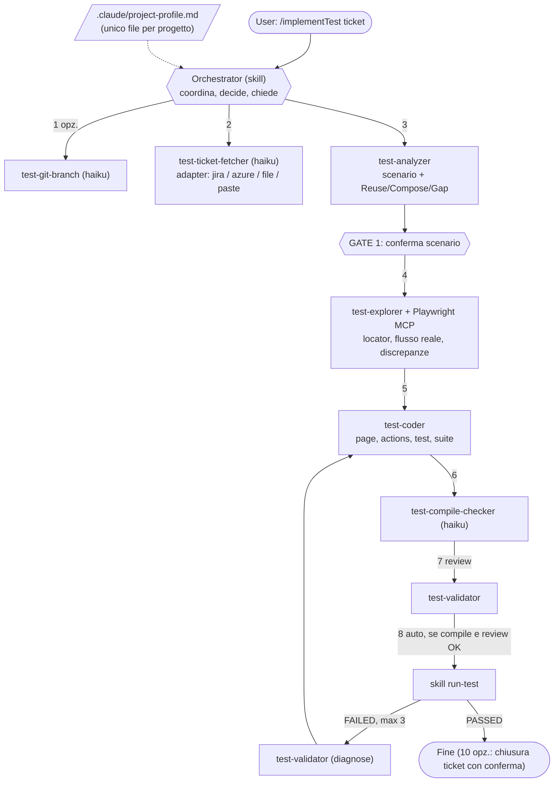

# implementTest — Architettura

L'orchestratore è una skill nel contesto principale. Gli agent eseguono compiti circoscritti e restituiscono output a formato fisso. Tutto ciò che dipende dal progetto sta in `.claude/project-profile.md`.

| Step | Chi | Output |
|---|---|---|
| 0 | Orchestrator | profilo letto, `TBD` risolti |
| 1 | test-git-branch | `STATUS` branch (opzionale) |
| 2 | test-ticket-fetcher | summary, gruppo, contratto, allegati |
| 3 | test-analyzer | scenario, mappa step, ambiguità |
| 4 | test-explorer | mappa elementi, flusso reale, discrepanze |
| 5 | test-coder | file creati, mappa step→codice |
| 6 | test-compile-checker | `OK` / `FAILED` / `ENVIRONMENT` |
| 7 | test-validator (review) | `OK` / `DIFETTI` / `STOP` |
| 8 | run-test | `PASSED` / `FAILED` |
| 9 | test-validator (diagnose) + coder | correzione minima, max 3 tentativi |

## Portare la pipeline su un nuovo progetto

1. Copia `.claude/` (agents, skills, profilo) e `.mcp.json`.
2. Compila `.claude/project-profile.md`: tracker, build/run, layout e convenzioni, ambiente, git.
3. Nessun agent o skill va modificato.

## Regole hard

- Mai commit/push/PR. Mai toccare librerie condivise senza permesso.
- Mai sostituire valori vincolati con random. Mai indebolire un'assert per far passare un test.
- Mai credenziali nell'output. Nel dubbio: stop e chiedi.
